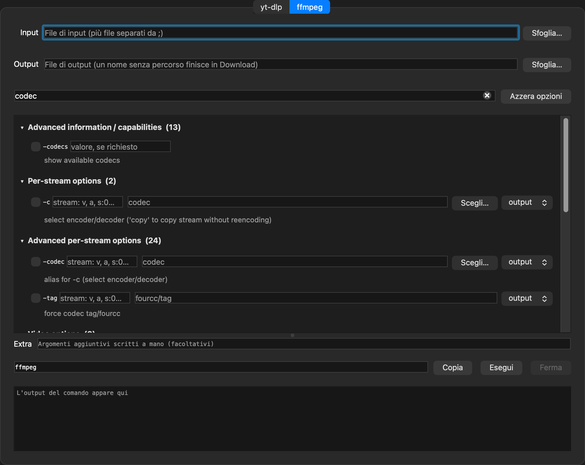

<p align="center"></p>

# DefDownloader

Un'interfaccia grafica per **yt-dlp** e **ffmpeg**: una sola finestra con due tab, in cui ogni opzione da riga di comando diventa una spunta o un campo.

Le opzioni non sono scritte a mano: all'avvio l'app (che si chiama `ytmlp`) legge l'help dei due programmi e costruisce l'interfaccia da lì. Così ci sono tutte, e restano allineate alla versione installata.



## Download

| Sistema | File |
| --- | --- |
| macOS (Apple Silicon, macOS 27 o successivo) | [ytmlp-macos-arm64.dmg](https://github.com/elia2810/DefDownloader/releases/latest/download/ytmlp-macos-arm64.dmg) |
| Windows (64 bit) | [ytmlp-windows-x64.zip](https://github.com/elia2810/DefDownloader/releases/latest/download/ytmlp-windows-x64.zip) |

Entrambi includono già yt-dlp, ffmpeg e ffprobe. Se sul computer sono già installati, l'app usa quelli.

Le app non sono firmate da uno sviluppatore registrato, quindi al primo avvio il sistema chiede conferma:

- **macOS**: Impostazioni → Privacy e sicurezza → "Apri comunque"
- **Windows**: "Ulteriori informazioni" → "Esegui comunque"

## Come si usa

- **Tab yt-dlp**: incolla uno o più URL, scegli la cartella di destinazione, attiva le opzioni che ti servono.
- **Tab ffmpeg**: scegli i file di input e di output. Codec, formati, pixel format e filtri si scelgono da un elenco con "Scegli…"; le opzioni valide sia per l'input sia per l'output hanno un selettore.
- **Ricerca**: le opzioni sono raggruppate nelle sezioni dell'help, chiuse all'inizio. Il campo di ricerca filtra per nome e per descrizione.
- **Comando**: in basso si compone il comando completo, che puoi copiare o eseguire; l'output appare in tempo reale.
- **Extra**: per argomenti scritti a mano, ad esempio un'opzione ripetuta più volte o le opzioni specifiche di un singolo codec di ffmpeg, che l'interfaccia non elenca.

## Compilare

Servono Qt 6, CMake e un compilatore C++17.

macOS, con Homebrew:

```bash
brew install qt cmake ninja yt-dlp ffmpeg
cmake -S . -B build -G Ninja -DCMAKE_BUILD_TYPE=Release -DCMAKE_PREFIX_PATH="$(brew --prefix qt)"
cmake --build build
open build/ytmlp.app
```

Per creare il `.dmg` da distribuire, con Qt e gli strumenti inclusi:

```bash
./fetch-yt-dlp-mac.sh
./package-mac.sh
```

Windows: la build è automatica, vedi [.github/workflows/windows.yml](.github/workflows/windows.yml). Parte a ogni push su `main` e, sui tag `v*`, allega lo zip alla release.

## Licenza

Il codice di questo progetto è rilasciato con licenza [MIT](LICENSE).

I pacchetti scaricabili contengono anche programmi di terzi, ciascuno con la propria licenza:

- [FFmpeg](https://ffmpeg.org), GPLv3. macOS: build di Homebrew, sorgente su <https://ffmpeg.org/download.html>. Windows: build di [yt-dlp/FFmpeg-Builds](https://github.com/yt-dlp/FFmpeg-Builds).
- [yt-dlp](https://github.com/yt-dlp/yt-dlp), Unlicense.
- [Qt 6](https://www.qt.io), LGPLv3, collegato dinamicamente.

Scaricare contenuti può violare i termini di servizio dei siti o il diritto d'autore: usa l'app solo per contenuti che hai il diritto di scaricare.
