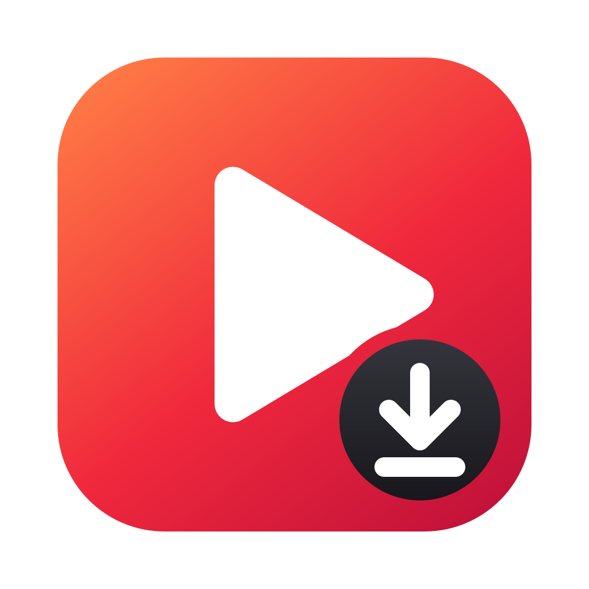
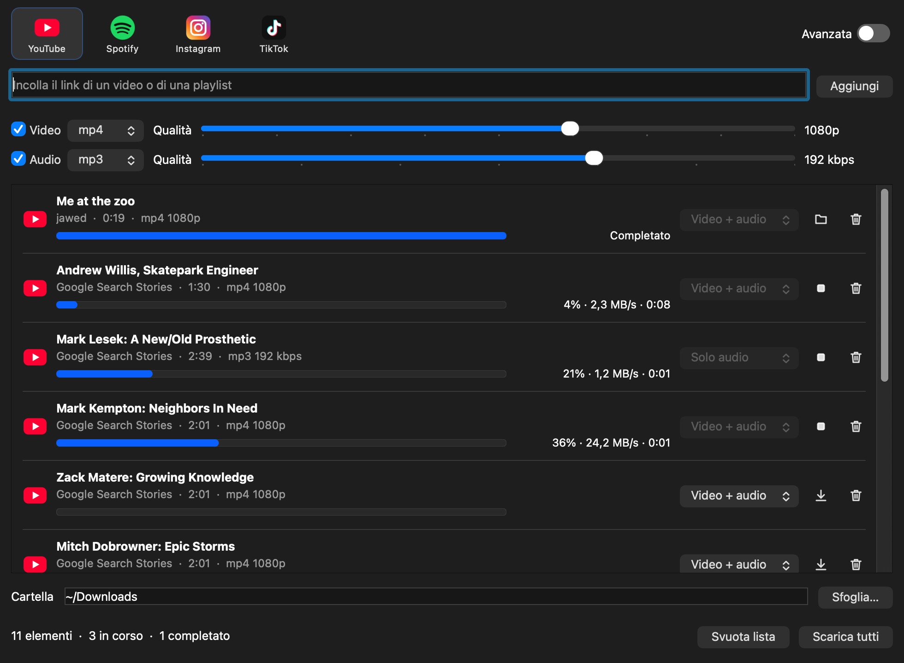
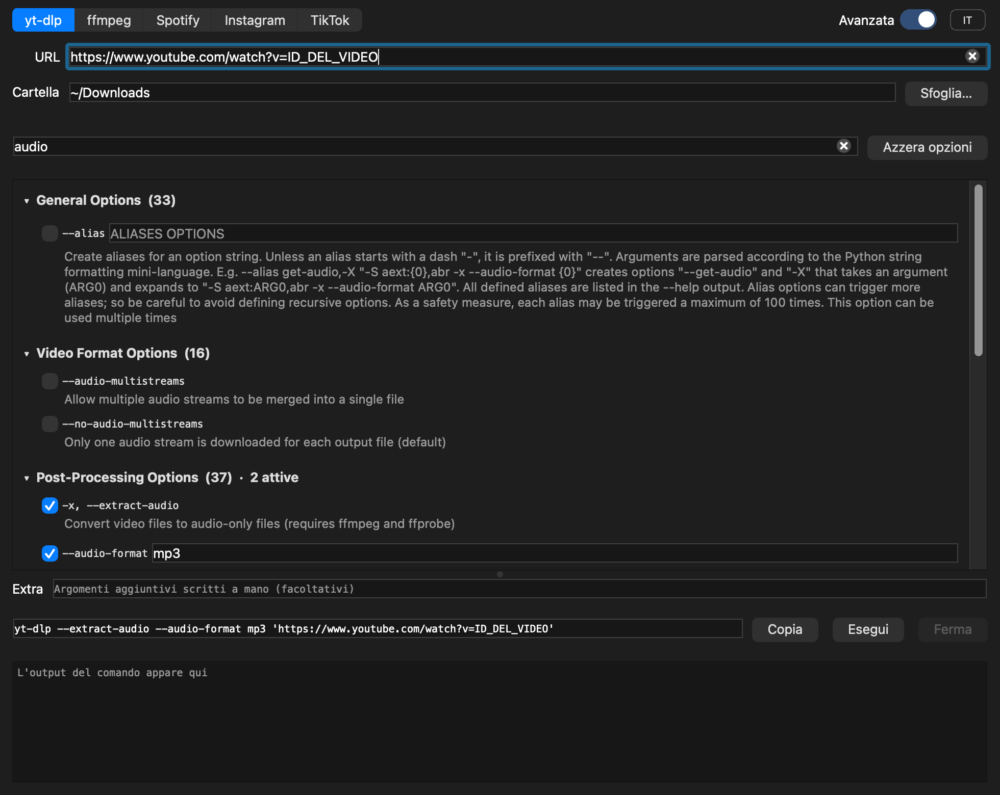
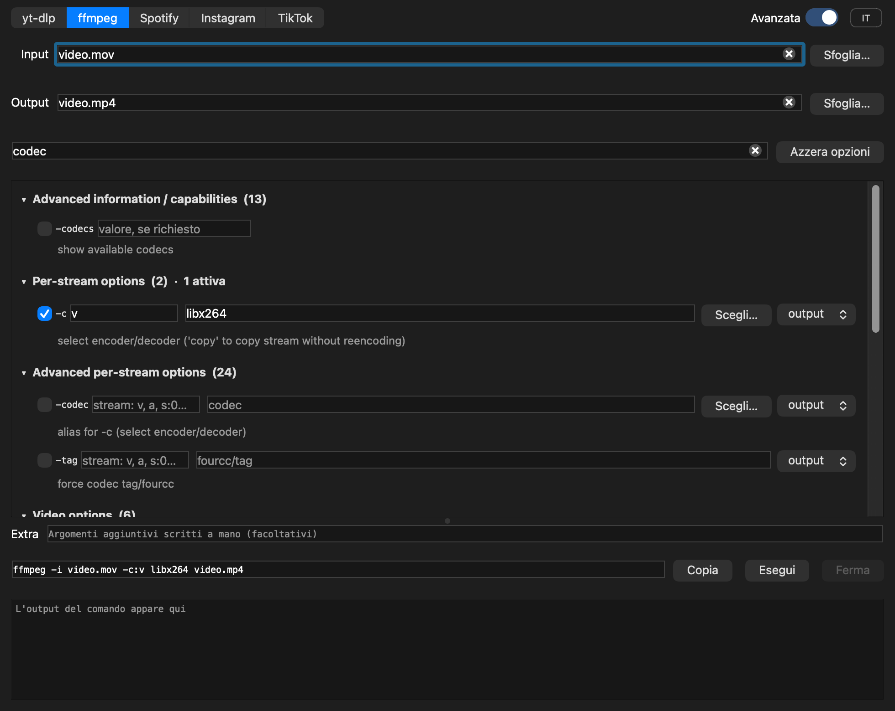
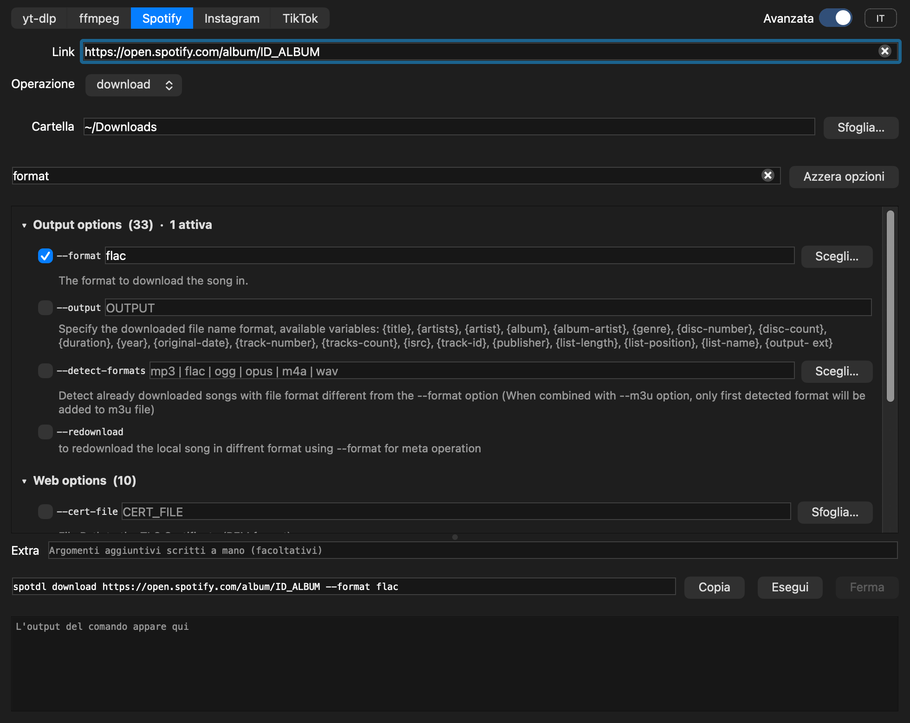
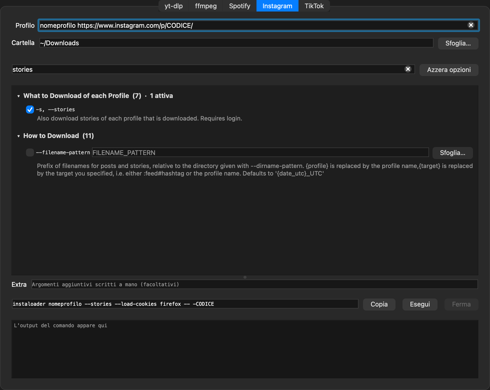

<p align="center"></p>

# DefDownloader

Un'interfaccia grafica per scaricare e convertire. Si apre su una schermata semplice: scegli il sito, incolli i link, scegli formato e qualità e scarichi. L'interruttore **Avanzata** in alto a destra mostra invece tutte le opzioni dei programmi a riga di comando che l'app usa.



## Schermata semplice

- **Sito**: YouTube, Spotify, Instagram o TikTok. Incollando un link il sito viene riconosciuto da solo; i link di altri siti passano da yt-dlp.
- **Link**: un link incollato diventa subito una riga della lista; una playlist (o un album di Spotify) aggiunge una riga per ogni elemento.
- **Video e Audio**: le due spunte decidono cosa scaricare; per ciascuno si scelgono il formato e, con il cursore, la qualità (risoluzione del video, bitrate dell'audio). Le scelte valgono per i link aggiunti dopo: ogni riga conserva quelle con cui è stata aggiunta.
- **Lista**: ogni riga ha il proprio menu "Video + audio / Solo video / Solo audio", il pulsante per scaricarla o fermarla, la barra di avanzamento con la velocità e il cestino per toglierla. "Scarica tutti" avvia tutta la lista, tre elementi alla volta.

Per Spotify e per i profili Instagram la barra indica solo che il download è in corso: spotDL e instaloader non comunicano la percentuale.

## Modalità avanzata

Una tab per strumento, in cui ogni opzione da riga di comando diventa una spunta o un campo.

| Tab | Strumento | Cosa fa |
| --- | --- | --- |
| yt-dlp | [yt-dlp](https://github.com/yt-dlp/yt-dlp) | Video e audio da YouTube e da molti altri siti, anche playlist e canali |
| ffmpeg | [FFmpeg](https://ffmpeg.org) | Conversione di audio e video |
| Spotify | [spotDL](https://github.com/spotDL/spotify-downloader) | Brani, album e playlist: i dati arrivano da Spotify, l'audio da YouTube |
| Instagram | [instaloader](https://instaloader.github.io) | Foto, video, storie e profili interi |
| TikTok | yt-dlp | Video di TikTok |

Le opzioni non sono scritte a mano: l'app legge l'help dei programmi e costruisce l'interfaccia da lì. Così ci sono tutte, e restano allineate alla versione installata.



| ffmpeg | Spotify | Instagram |
| --- | --- | --- |
|  |  |  |

## Download

Scarica l'ultima versione dalla [pagina delle release](https://github.com/elia2810/DefDownloader/releases/latest):

| Sistema | File | Come si installa |
| --- | --- | --- |
| macOS (Apple Silicon, macOS 27 o successivo) | `DefDownloader-macos-arm64.dmg` | Apri il dmg e trascina l'app in Applicazioni |
| Windows (64 bit) | `DefDownloader-windows-x64.zip` | Estrai la cartella e avvia `DefDownloader.exe` |

Entrambi includono già tutti gli strumenti (yt-dlp, ffmpeg, ffprobe, spotDL, instaloader). Se sul computer sono già installati, l'app usa quelli.

Le app non sono firmate da uno sviluppatore registrato, quindi al primo avvio il sistema chiede conferma:

- **macOS**: Impostazioni → Privacy e sicurezza → "Apri comunque"
- **Windows**: "Ulteriori informazioni" → "Esegui comunque"

## Come si usa la modalità avanzata

- **Tab yt-dlp**: incolla uno o più URL, scegli la cartella di destinazione, attiva le opzioni che ti servono.
- **Tab ffmpeg**: scegli i file di input e di output. Codec, formati, pixel format e filtri si scelgono da un elenco con "Scegli…"; le opzioni valide sia per l'input sia per l'output hanno un selettore.
- **Tab Spotify**: incolla il link di un brano, un album, una playlist o un artista, oppure scrivi `"titolo artista"` tra virgolette. "Operazione" sceglie cosa fare (`download` è quella normale).
- **Tab Instagram**: scrivi il nome di un profilo o incolla il link di un profilo, di un post o di un reel. Instagram limita molto chi non è collegato: per storie, profili privati o molti download serve il login, ad esempio con l'opzione `--load-cookies` e il nome del browser in cui sei già collegato.
- **Tab TikTok**: incolla il link di un video. Per scaricare un profilo intero TikTok chiede il login: usa `--cookies-from-browser`.
- **Ricerca**: le opzioni sono raggruppate nelle sezioni dell'help, chiuse all'inizio. Il campo di ricerca filtra per nome e per descrizione.
- **Comando**: in basso si compone il comando completo, che puoi copiare o eseguire; l'output appare in tempo reale.
- **Extra**: per argomenti scritti a mano, ad esempio un'opzione ripetuta più volte o le opzioni specifiche di un singolo codec di ffmpeg, che l'interfaccia non elenca.

## Compilare

Servono Qt 6, CMake e un compilatore C++17.

macOS, con Homebrew:

```bash
brew install qt cmake ninja yt-dlp ffmpeg
./fetch-tools-mac.sh   # spotDL e instaloader, in vendor/mac
cmake -S . -B build -G Ninja -DCMAKE_BUILD_TYPE=Release -DCMAKE_PREFIX_PATH="$(brew --prefix qt)"
cmake --build build
PATH="$PWD/vendor/mac:$PATH" build/DefDownloader.app/Contents/MacOS/DefDownloader
```

Per creare il `.dmg` da distribuire, con Qt e gli strumenti inclusi:

```bash
./fetch-tools-mac.sh
./package-mac.sh
```

Windows: la build è automatica, vedi [.github/workflows/windows.yml](.github/workflows/windows.yml). Parte a ogni push su `main` e, sui tag `v*`, allega lo zip alla release.

## Licenza

Il codice di questo progetto è rilasciato con licenza [MIT](LICENSE).

I pacchetti scaricabili contengono anche programmi di terzi, ciascuno con la propria licenza:

- [FFmpeg](https://ffmpeg.org), GPLv3. macOS: build di Homebrew, sorgente su <https://ffmpeg.org/download.html>. Windows: build di [yt-dlp/FFmpeg-Builds](https://github.com/yt-dlp/FFmpeg-Builds).
- [yt-dlp](https://github.com/yt-dlp/yt-dlp), Unlicense.
- [spotDL](https://github.com/spotDL/spotify-downloader), MIT.
- [instaloader](https://github.com/instaloader/instaloader), MIT.
- [Qt 6](https://www.qt.io), LGPLv3, collegato dinamicamente.

Scaricare contenuti può violare i termini di servizio dei siti o il diritto d'autore: usa l'app solo per contenuti che hai il diritto di scaricare.
